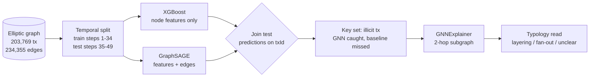
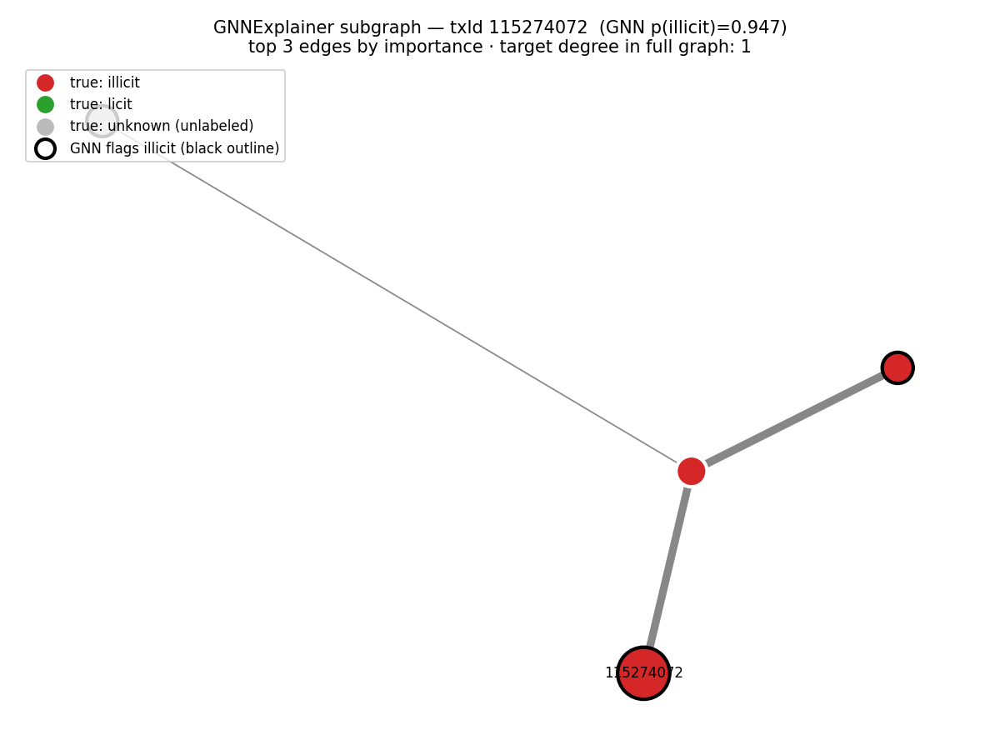
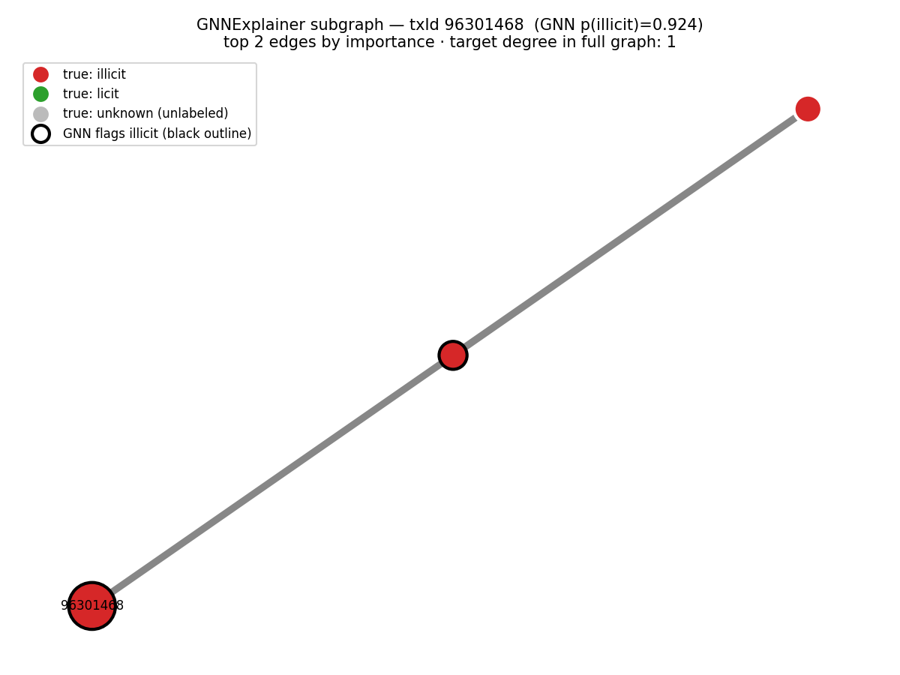
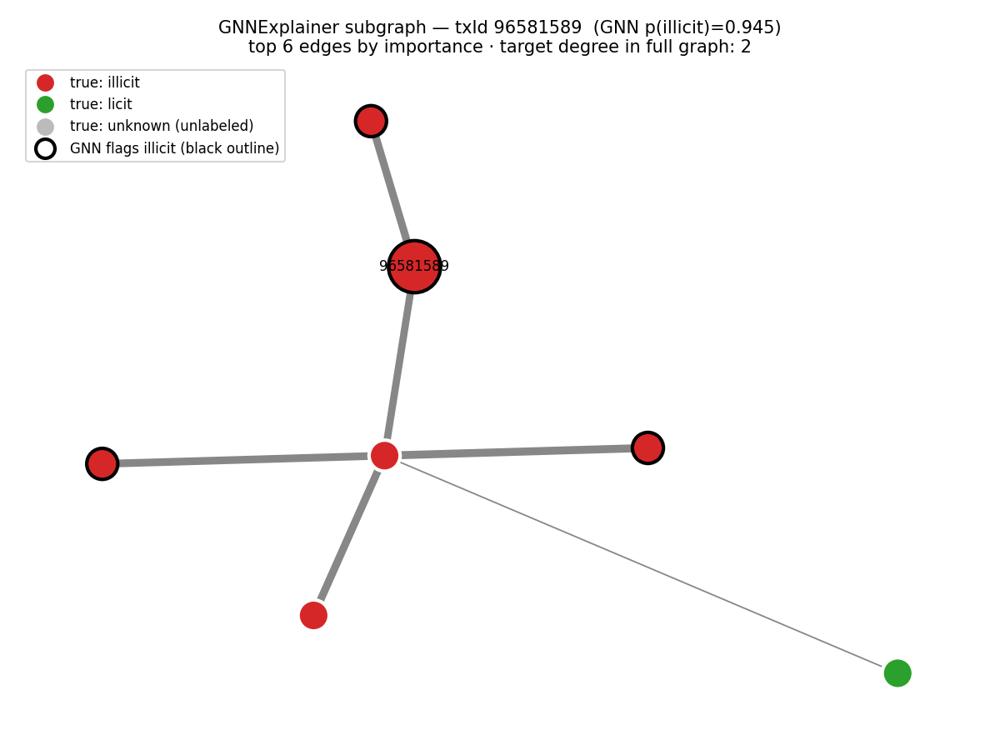
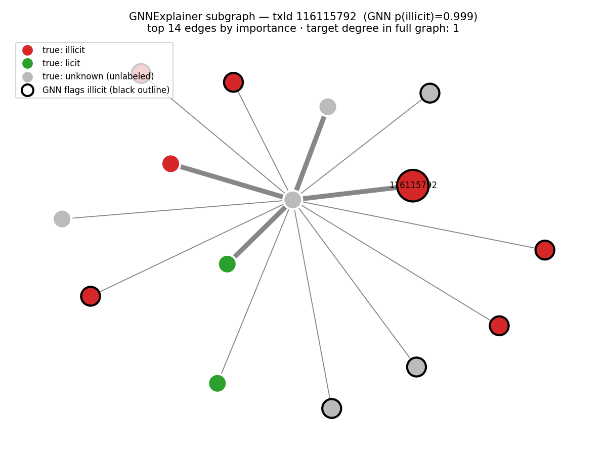
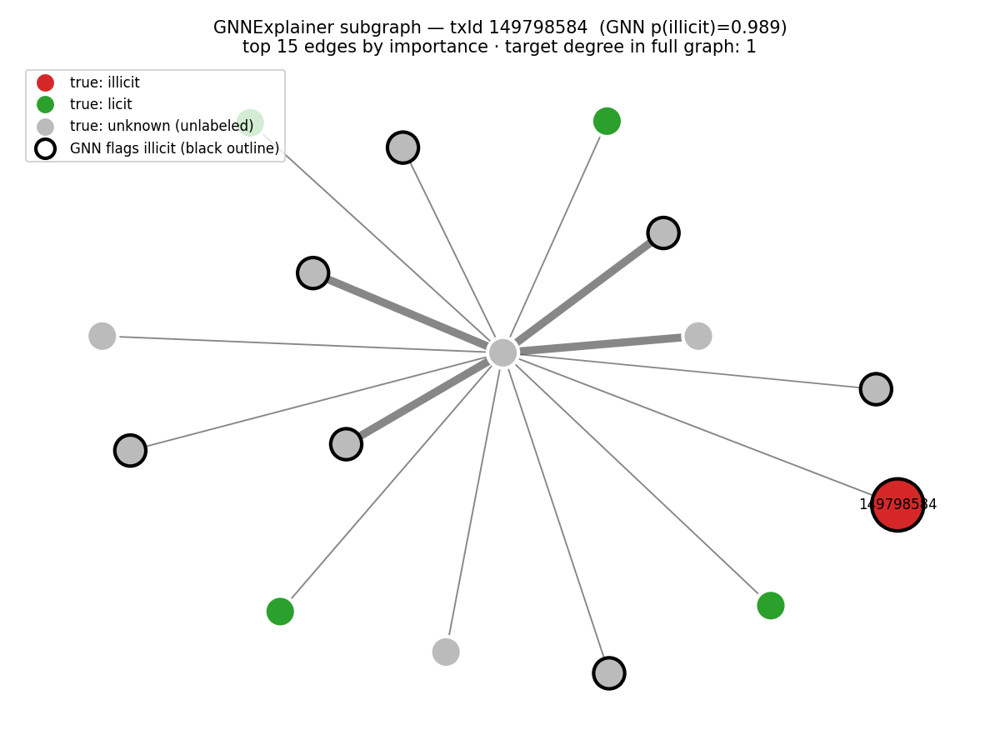
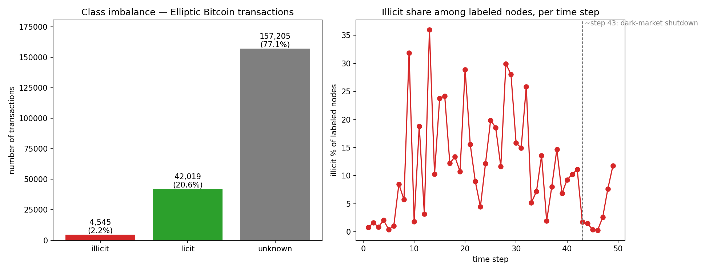

# Explainable AML Detection on the Elliptic Bitcoin Graph

[](https://github.com/AdityaShekhawat0504/elliptic-aml-gnn/actions/workflows/ci.yml)

**A GraphSAGE GNN and an XGBoost baseline compared on 203k Bitcoin transactions. GNNExplainer then shows *which* laundering patterns only the graph can catch.**

## Problem
Anti-money-laundering (AML) teams drown in alerts, so false positives, not
accuracy, are the real cost in triage. A flag is only useful if an analyst can
see *why* it fired. This repo asks a narrow question: on the public
[Elliptic](https://www.kaggle.com/datasets/ellipticco/elliptic-data-set) Bitcoin
transaction graph, what does a graph model catch that a strong feature-only model
misses, and can each catch be explained as a recognisable typology (layering,
fan-out, clustered movement of funds)?

## How it works

Both models see the **identical** labeled test nodes. The disagreement between
them isolates the graph-only signal, and GNNExplainer turns each of those cases
into an auditable subgraph. More detail is in [docs/ARCHITECTURE.md](docs/ARCHITECTURE.md).

## Results
Test set: 16,670 labeled transactions in steps 35–49 (illicit class).

| Model                     | Precision | Recall | F1   | False-positive rate          |
|---------------------------|----------:|-------:|-----:|------------------------------|
| XGBoost (features only)   | 0.86      | 0.74   | 0.79 | **0.84%** (131 of 15,587 licit) |
| GraphSAGE (graph)         | 0.68      | 0.65   | 0.67 | 2.10% (327 of 15,587 licit)  |

- **On raw metrics the GNN does not beat XGBoost.** This matches published
  results on this dataset, where a mid-timeline distribution shift makes the
  later test steps hard for any model.
- **The GNN uniquely caught 16 illicit transactions that the baseline missed.**
  Almost all of them are **degree-1 or degree-2 nodes**. A feature-only model
  sees nothing unusual about them, but they sit one or two hops from known
  illicit activity. This is guilt-by-association, often through a short
  **layering** chain or a fan-out hub, and XGBoost structurally cannot see it.
- The graph signal **complements** the baseline. It does not replace it: the
  baseline uniquely catches 108 cases.

Both models use the **exact same temporal split**: 29,894 labeled train nodes in
steps 1–34 and 16,670 labeled test nodes in steps 35–49. `gnn.py` builds the
split from time steps directly rather than from the dataset's built-in masks.
The baseline uses node features only, with no edges. Confusion matrices on the
test set:

XGBoost baseline:

|                  | pred licit | pred illicit |
|------------------|-----------:|-------------:|
| **true licit**   |     15,456 |          131 |
| **true illicit** |        287 |          796 |

GNN (GraphSAGE):

|                  | pred licit | pred illicit |
|------------------|-----------:|-------------:|
| **true licit**   |     15,260 |          327 |
| **true illicit** |        379 |          704 |

### What the graph catches that features miss
The two models agree far more than they disagree — but the disagreement is the
interesting part. Joining the two prediction sets on `txId` (steps 35–49):

| Disagreement set                          | Count |
|--------------------------------------------|------:|
| **GNN caught, baseline missed** (key set)  |  **16** |
| baseline caught, GNN missed                |   108 |
| both caught (overlap)                      |   688 |
| both missed                                |   271 |

The GNN is **not** a net win on raw counts — it uniquely misses more than it
uniquely catches. But the 16 it *uniquely* catches share a structure (see
*Explainer examples*): they are low-degree transactions a feature-only model
treats as ordinary, flagged by the GNN because their 2-hop neighbourhood
touches illicit activity. The graph signal is **complementary** to the
baseline, not a replacement for it.

The dataset is severely imbalanced — only
**2.23% of all transactions are labeled illicit** — and carries a known
mid-timeline distribution shift that will make the later test steps the hard
part of the problem. Details below.

## Explainer examples
GNNExplainer was run on the 5 highest-confidence cases from the **key set** —
the 16 illicit transactions the GNN flagged that the XGBoost baseline missed.
Each figure shows the flagged transaction (large, labelled with its `txId`) and
the most important edges GNNExplainer surfaced; nodes are coloured by their
**true class** and GNN-flagged-illicit nodes carry a **black outline**.

The recurring structure across the key set: the flagged transaction has only
**1–2 direct edges** of its own — invisible to a feature-only model — but the
graph reaches two hops out and connects it to illicit activity.

### txId 115274072 — short illicit chain → layering

The transaction has a single edge. The explainer surfaces a short chain:
flagged tx → illicit tx → illicit tx, with two of its three neighbours
themselves labelled illicit. This reads cleanly as **layering** — a
pass-through link in a chain of illicit transactions, exactly the structure a
feature-only model cannot see.

### txId 96301468 — minimal pass-through chain → layering

The smallest case: a 3-node chain, flagged tx → illicit → illicit, both visible
neighbours illicit. Same **layering / pass-through** read as above, and the
same reason the baseline missed it — in isolation the node's own features are
unremarkable.

### txId 96581589 — edge of an illicit cluster → layering / clustered movement

The transaction has two edges; one leads into a small dense pocket where 5 of 6
visible neighbours are illicit. The flagged tx sits on the **edge of an illicit
cluster** — consistent with clustered movement of funds / layering, though the
target is peripheral to the cluster rather than central to it.

### txId 116115792 — fan-out hub → possible layering (partly circumstantial)

The transaction has one edge, to an **unlabeled intermediary that fans out to
14 other transactions** — a star / hub shape. Six of those rim nodes are
illicit and several more are independently GNN-flagged. The hub-and-spoke shape
is consistent with a one-to-many **layering** split, but because the hub itself
is unlabeled the typology read is **partly circumstantial** — the structure
supports it, the labels only partly corroborate it.

### txId 149798584 — fan-out hub, but typology unclear (honest negative)

Structurally a near-twin of the previous case: one edge into an unlabeled
intermediary that fans out to 15 transactions. But here the visible neighbours
are **0 illicit / 4 licit / 11 unknown** — no illicit corroboration in the
surfaced subgraph at all. The GNN is highly confident (p = 0.989), yet the
explainer does **not** support a clean money-laundering typology here. We
report this one as **unclear** rather than forcing a layering label onto it —
the credibility of the other four reads depends on not overclaiming this one.

## Dataset
Elliptic Bitcoin Dataset — 203,769 transactions, 234,355 directed payment
edges, 165 features, 49 time steps. Loaded via
`torch_geometric.datasets.EllipticBitcoinDataset`.

### Class imbalance (from `eda.py`)
| Class    | Count   | Share  |
|----------|---------|--------|
| illicit  | 4,545   | 2.23%  |
| licit    | 42,019  | 20.62% |
| unknown  | 157,205 | 77.15% |

Only 22.85% of nodes carry a label at all; among labeled nodes the illicit
share is 9.76%. Any baseline must be judged on illicit-class precision/recall,
not accuracy.



### Temporal structure & distribution shift
The 49 time steps are confirmed present. The standard temporal split uses
steps 1–34 for training and 35–49 for testing. There is a well-documented
distribution shift around **time step ~43** — attributed to the sudden shutdown
of a dark marketplace — after which the illicit share collapses (steps 44–46
fall to 1.51% / 0.41% / 0.28% of labeled nodes). This is a known property of
the dataset, not noise: it is why temporal splits are used and why later test
steps are expected to be hard. We do **not** model the time axis explicitly
(no temporal GNN) — we only report it so later metrics are read in context.

## Quickstart
Requires Python 3.12 (the version CI tests; 3.13 also works). No API keys, secrets or environment variables are needed,
so the repo has no `.env` file.

```bash
git clone https://github.com/AdityaShekhawat0504/elliptic-aml-gnn.git
cd elliptic-aml-gnn
python -m venv venv && source venv/bin/activate
pip install -r requirements.txt --extra-index-url https://download.pytorch.org/whl/cpu
```
macOS only: xgboost needs the OpenMP runtime, so run `brew install libomp`
first. On macOS, omit `--extra-index-url`, because the default torch wheel is
already CPU-only there.

**Verify the install (seconds, no download):**
```bash
pip install -r requirements-dev.txt --extra-index-url https://download.pytorch.org/whl/cpu
pytest
```

**Reproduce the results.** Run the scripts in this order, because each one
reads the previous one's outputs:
```bash
python eda.py        # downloads the dataset to data/ and writes figures/class_imbalance.png
python baseline.py   # XGBoost baseline -> outputs/baseline_test_predictions.csv
python gnn.py        # GraphSAGE (CPU)  -> outputs/gnn_test_predictions.csv + outputs/gnn_model.pt
python explain.py    # disagreement analysis + GNNExplainer -> figures/explain_*.png
```
`eda.py` downloads the Elliptic dataset through PyTorch Geometric on its first
run, which is a large download. `baseline.py` reads the raw CSVs from that
download, so run `eda.py` first. All scripts are seeded (`SEED = 42`).
`outputs/gnn_model.pt` is gitignored and regenerated by `gnn.py`. The two
prediction CSVs are committed, so you can inspect results without re-running
anything.

## Stack
Python · PyTorch · PyTorch Geometric (GraphSAGE, GNNExplainer) · XGBoost ·
scikit-learn · pandas · NetworkX · Matplotlib · pytest · Ruff · GitHub Actions.
Versions are pinned in `requirements.txt`.

## Limitations
- **The GNN loses on headline metrics.** Its F1 is 0.67 against 0.79 and its
  false-positive rate is 2.10% against 0.84%. The case for the graph model rests
  on the 16 complementary catches, not on beating the baseline.
- **Distribution shift is reported, not modelled.** The illicit share collapses
  after the step ~43 dark-market shutdown, and there is no temporal GNN or
  retraining over time.
- **No hyperparameter search.** Each model uses one reasonable config, so these
  numbers are not tuned upper bounds.
- **Explanations are qualitative.** Typology labels come from reading 5
  GNNExplainer subgraphs by hand, and one of them (txId 149798584) is reported
  as *unclear*. The labels are not validated against ground-truth typologies,
  because Elliptic does not provide any.
- **Anonymised features.** Elliptic's 165 features are unnamed, so
  feature-level explanations are not meaningful. Only structural (edge)
  explanations are.
- **Single dataset, offline batch only.** There is no serving path, streaming
  or calibration of alert thresholds.
