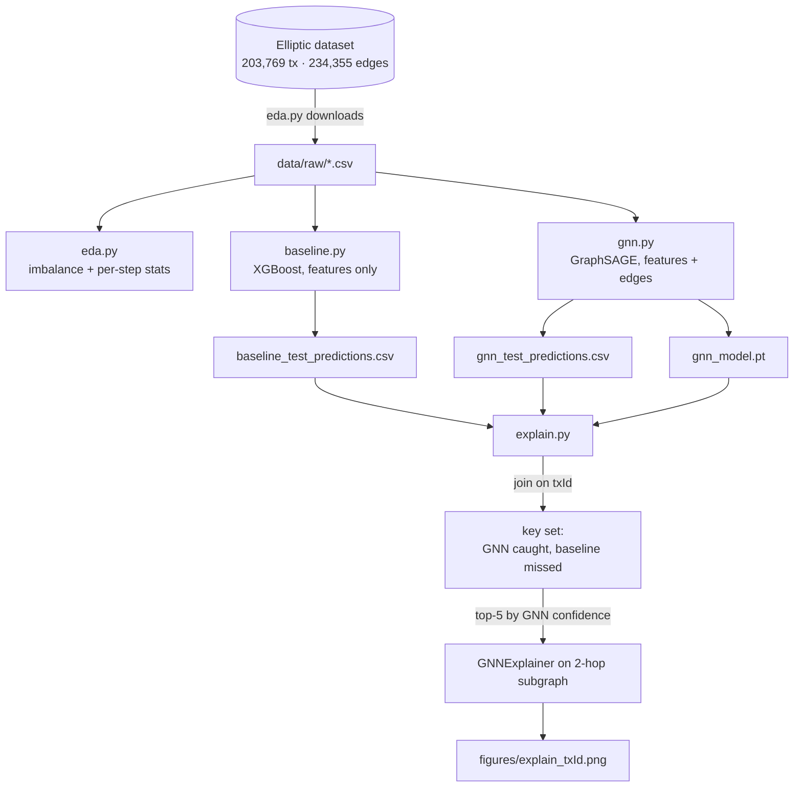

# Architecture

Four standalone scripts, run in order. Each one reads what the previous one
wrote to disk. There is no shared package, server or database, and nothing calls
an LLM or an external API. The only network call is the one-time dataset download.

## Components

| Script        | Role                                                                 | Reads                                         | Writes                                   |
|---------------|----------------------------------------------------------------------|-----------------------------------------------|------------------------------------------|
| `eda.py`      | Downloads the dataset and reports class imbalance and temporal structure | PyG `EllipticBitcoinDataset` (downloads to `data/`) | `figures/class_imbalance.png`            |
| `baseline.py` | XGBoost on node features only, with no edges                         | `data/raw/*.csv`                              | `outputs/baseline_test_predictions.csv`  |
| `gnn.py`      | 2-layer GraphSAGE on the full graph                                  | `data/` (PyG) + `data/raw/elliptic_txs_features.csv` | `outputs/gnn_test_predictions.csv`, `outputs/gnn_model.pt` |
| `explain.py`  | Disagreement analysis + GNNExplainer subgraphs                       | both prediction CSVs, `outputs/gnn_model.pt`  | `figures/explain_<txId>.png`             |

`explain.py` imports `GraphSAGE`, `load` and its constants from `gnn.py`, so the
explainer runs on exactly the model definition and split that training used.

## Data flow

## Key decisions

- **Temporal split, built from time steps in both models.** Train on steps 1–34
  and test on 35–49, using labeled nodes only. `gnn.py` builds its masks from the
  raw `time_step` column rather than PyG's built-in masks, so its test set is
  provably the same as the baseline's. `tests/test_gnn.py` checks this.
- **Feature-only baseline as the comparison anchor.** XGBoost sees no graph, so
  any illicit node the GNN catches and the baseline misses is evidence of graph
  signal rather than better feature handling.
- **Semi-supervised message passing.** GraphSAGE passes messages over all nodes,
  including the ~77% unknown ones. Loss is computed only on labeled training
  nodes. Edges are made undirected, which is standard for this dataset.
- **Imbalance by class weighting, not resampling.** XGBoost uses
  `scale_pos_weight`. The GNN uses a weighted cross-entropy with the same
  licit/illicit ratio. Neither model has a hyperparameter search; each uses one
  reasonable config.
- **Reproducibility.** Everything uses `SEED = 42`, and the GNN trains on CPU,
  where the run is deterministic. The disagreement analysis depends on this
  because it joins two runs' predictions.
- **Explain on the 2-hop subgraph.** A 2-layer GNN's prediction depends only on
  the node's 2-hop neighbourhood, so GNNExplainer runs on that subgraph for
  speed. An assertion checks that the subgraph prediction matches the full-graph
  one.
- **Process separation for OpenMP.** `baseline.py` never imports torch, and
  `gnn.py`/`explain.py` never import xgboost. On macOS, loading both OpenMP
  runtimes into one process can crash. (Linux CI runs the tests in one process
  and has no problem.)
- **Legible figures over complete ones.** Each explainer figure keeps the top 15
  edges by importance. The target node is always included.
